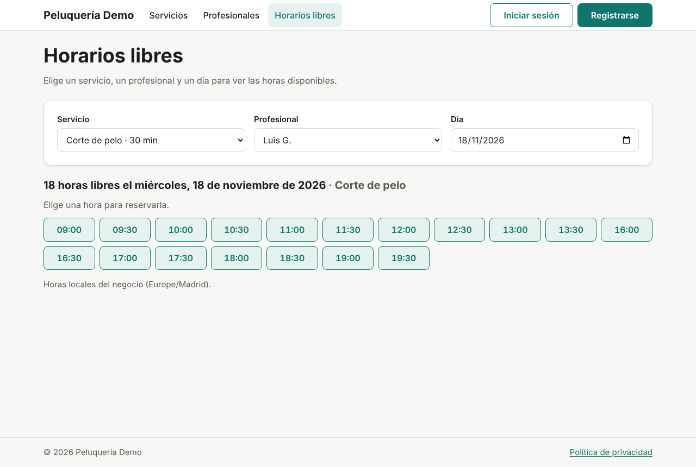
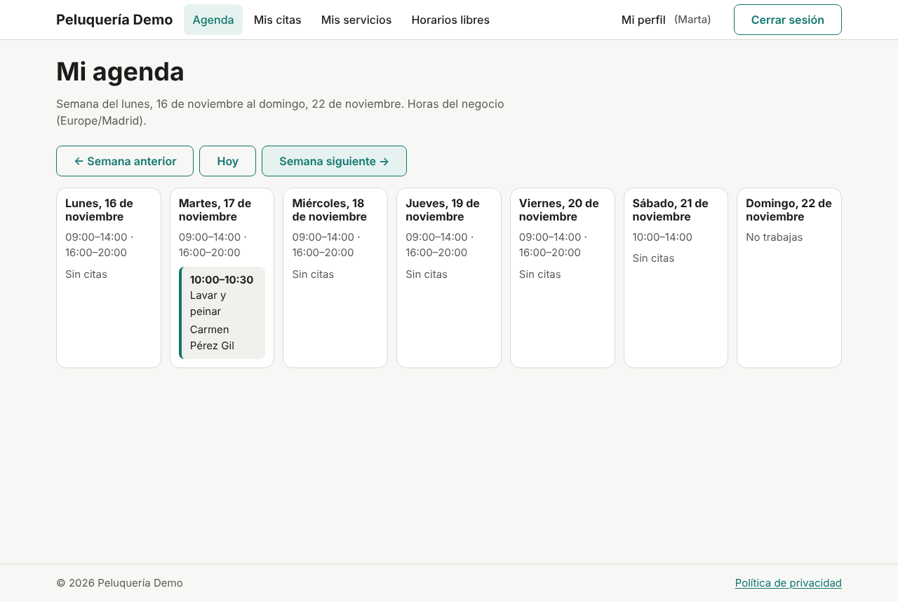
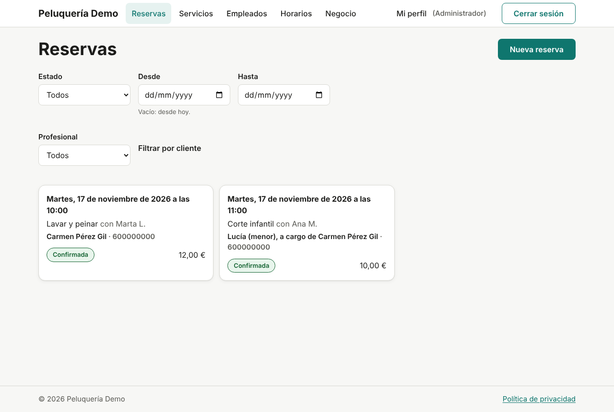
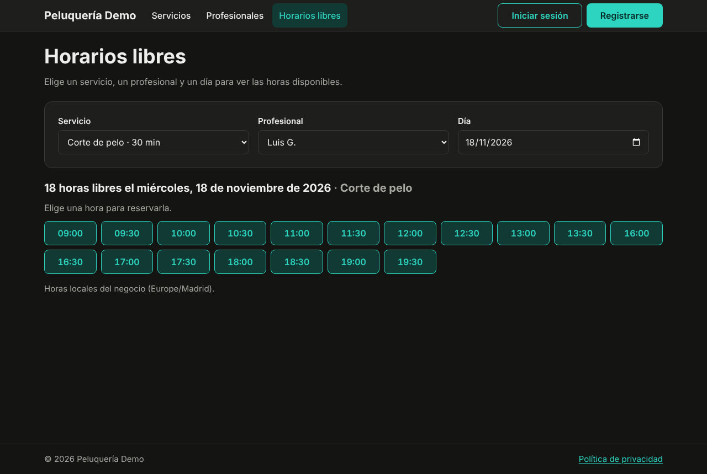

# GestionDeCitas

[](https://github.com/josedfc20/gestion-de-citas/actions/workflows/ci.yml)
[](LICENSE)

🇪🇸 [Leer en español](README.md)

A web application to **book and manage appointments** for businesses with
several professionals and services. Customers book online based on each
professional's real availability; staff see their schedule, and the
administrator manages services, opening hours and bookings in one place.

The first use case is a hair salon, but the design is generic (business,
professional, service, appointment) so it can be adapted to garages, clinics
or beauty centres. It is an end-to-end project: analysis, UML design,
architecture, development, testing and documentation.

> **Language note:** the user interface, the code, the API descriptions and
> the rest of the documentation are in Spanish. This page is the English
> entry point.

| A professional's free slots | Employee's weekly schedule |
|---|---|
|  |  |
| **Administrator's bookings** | **Dark mode** |
|  |  |

## What it does

| Role | Can… |
|---|---|
| **Visitor** | Browse services and prices, professionals and free slots; sign up (age 14 or over) |
| **Customer** | Book for themselves or for a child in their care, view and cancel bookings (up to 24 h before), edit their profile, download their data and delete their account |
| **Employee** | View their weekly schedule and appointments, mark them as completed or no-show, and check their services |
| **Administrator** | Manage services, employees, opening hours, closing days and business settings; view every booking, book on behalf of a customer and cancel |

Things that got special care:

- **Never two overlapping appointments** for the same professional, even if
  two customers book at the same instant: the database itself prevents it
  ([ADR-004](docs/decisiones/ADR-004-no-solape-en-la-base-de-datos.md)).
- **Times are always in the business's time zone**, including daylight
  saving changes ([ADR-013](docs/decisiones/ADR-013-horas-en-la-zona-del-negocio.md)).
- **GDPR:** consent, data export, and account deletion that anonymises
  personal data ([ADR-010](docs/decisiones/ADR-010-anonimizar-en-vez-de-borrar.md)).
- **Secure sessions:** 15-minute JWT plus a rotating refresh token in an
  `HttpOnly` cookie ([ADR-007](docs/decisiones/ADR-007-jwt-y-refresh-rotado.md)).
- **Mobile first and accessible** (WCAG 2.1 AA checked with axe in light and
  dark mode).

## Tech stack

| Area | Technology |
|---|---|
| Backend | Java 21, Spring Boot 4.1 (Web MVC, Security, Data JPA, Validation), REST API documented with OpenAPI |
| Database | PostgreSQL 16 with Flyway migrations |
| Web | React 19, TypeScript 7, Vite, React Router, TanStack Query, React Hook Form + Zod, CSS Modules |
| Testing | JUnit 5, Testcontainers, ArchUnit, Vitest, Testing Library, MSW, Playwright, axe |
| Infrastructure | Docker Compose, GitHub Actions |

## Run it locally

You need JDK 21, Node.js 24, Docker and Git.

```bash
git clone https://github.com/josedfc20/gestion-de-citas.git && cd gestion-de-citas
cp .env.example .env          # change the passwords, JWT_SECRET and DEMO_PASSWORD
docker compose up -d          # PostgreSQL (port 5433) and Mailpit
cd backend && SPRING_PROFILES_ACTIVE=demo ./mvnw spring-boot:run
```

In another terminal:

```bash
cd frontend && npm install && npm run dev    # http://localhost:5173
```

The `demo` profile creates a sample hair salon with 6 services, 3
professionals and 2 appointments. Every account uses the password you set in
`DEMO_PASSWORD`:

| Account | Role |
|---|---|
| `cliente@demo.invalid` | Customer (Carmen, with a child in her care) |
| `luis@demo.invalid`, `ana@demo.invalid`, `marta@demo.invalid` | Employees |
| The `ADMIN_EMAIL` from `.env` | Administrator |

- Swagger: http://localhost:8080/swagger-ui.html
- Emails (password recovery): http://localhost:8025

Step-by-step guides (in Spanish, for Windows): [backend](docs/guias/arrancar-backend.md)
and [web](docs/guias/arrancar-web.md). How each screen works:
[user manual](docs/guias/manual-de-usuario.md).

## Tests

| Level | Command | Result (phase 5) |
|---|---|---|
| Backend: unit, integration against a real PostgreSQL, permissions and architecture | `cd backend && ./mvnw verify` | 512 tests, 98 % line and 89 % branch coverage |
| Web: components against a mocked API | `cd frontend && npm run test:cobertura` | 299 tests, 93 % line and 82 % branch coverage |
| End to end: browser, web, backend and database | `cd e2e && npx playwright test` | 25 tests: main flows, 390 px mobile, accessibility and simultaneous booking |

CI runs all three levels on every PR and fails if coverage drops below 95/85
(backend) or 90/80 (web). Details in the
[test report](docs/pruebas/informe-de-pruebas.md).

## Structure

```
gestion-de-citas/
├── backend/    REST API with Spring Boot (modular monolith, package by feature)
├── frontend/   web app with React + TypeScript
├── e2e/        end-to-end tests with Playwright
├── docs/       documentation: decisions, diagrams, API, guides and tests
└── AGENTS.md   project rules for AI assistants
```

## Documentation

Start with the [`docs/` index](docs/README.md). The most useful parts:

- [Technical decisions (ADR)](docs/decisiones/README.md): why the application is the way it is.
- [Diagrams](docs/diagramas/): use cases, classes, database, containers, sequences and states.
- [API](docs/api/README.md): OpenAPI specification, always up to date.
- [`docs/Doc.docx`](docs/Doc.docx): the full project document, phase by phase.

## License and author

[MIT](LICENSE) © 2026 Jose Flores.
