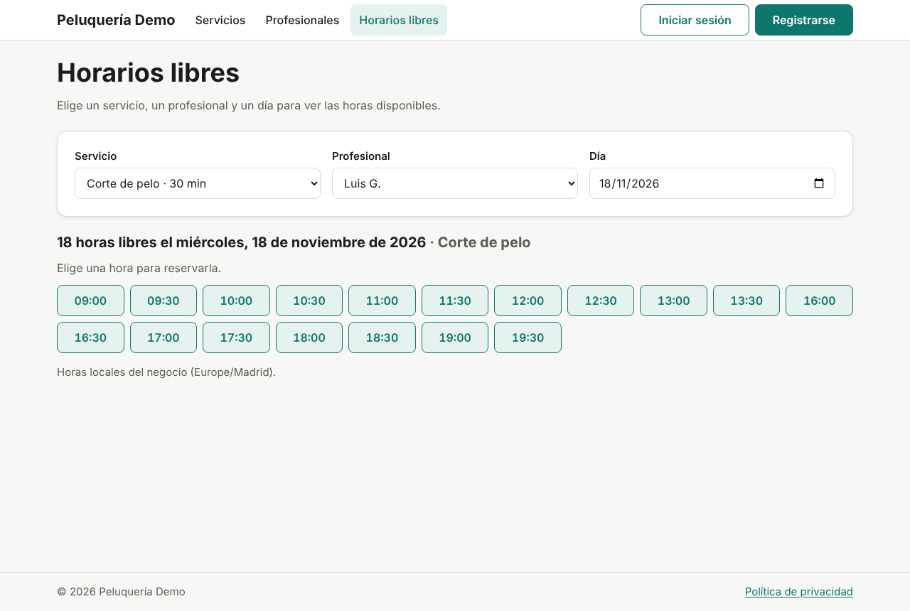
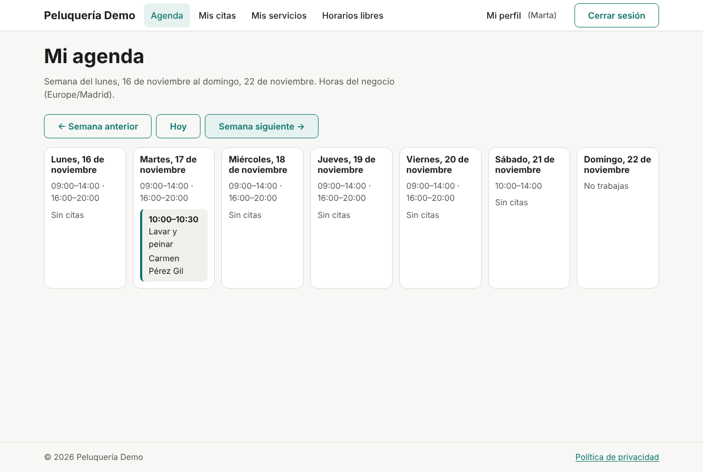
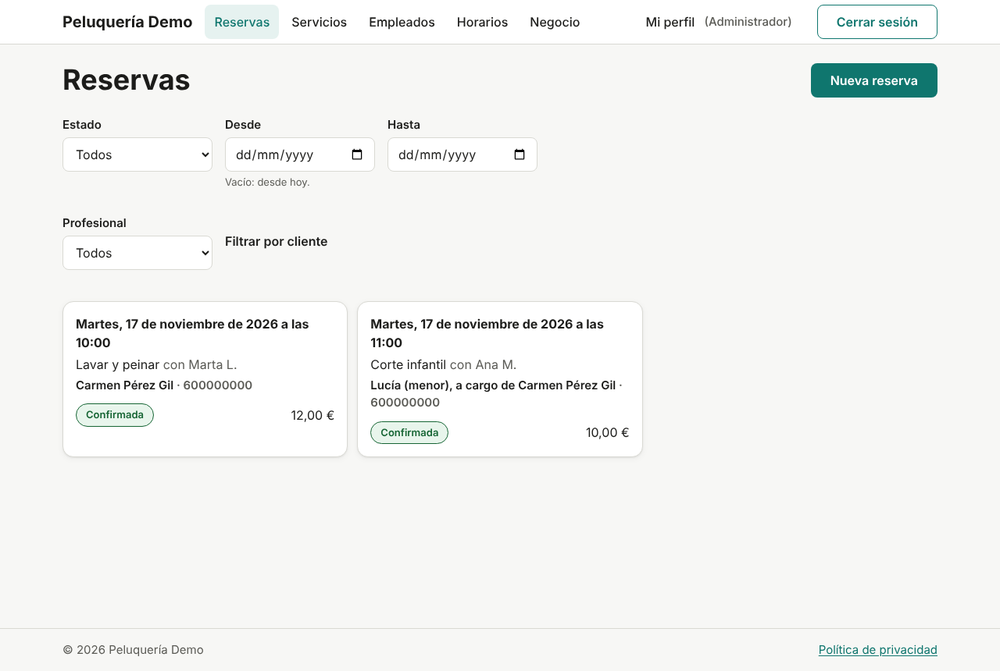
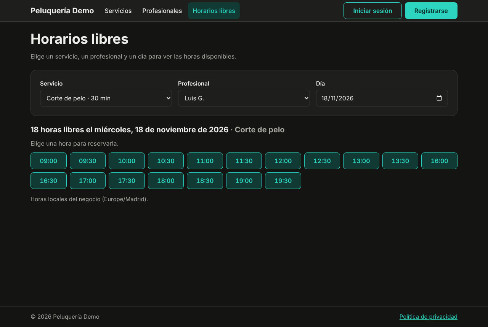

# GestionDeCitas

[](https://github.com/josedfc20/gestion-de-citas/actions/workflows/ci.yml)
[](LICENSE)

🇬🇧 [Read this in English](README.en.md)

Aplicación web para **reservar y gestionar citas** en negocios con varios
profesionales y servicios. Los clientes reservan en línea según la
disponibilidad real de cada profesional; los empleados ven su agenda y el
administrador gestiona servicios, horarios y reservas desde un solo sitio.

El primer caso es una peluquería, pero el diseño es genérico (negocio,
profesional, servicio, cita) para adaptarlo a talleres, consultas o centros
de estética. Es un proyecto completo de principio a fin: análisis, diseño
UML, arquitectura, desarrollo, pruebas y documentación.

| Horas libres de un profesional | Agenda semanal del empleado |
|---|---|
|  |  |
| **Reservas del administrador** | **Modo oscuro** |
|  |  |

## Qué hace

| Perfil | Puede… |
|---|---|
| **Visitante** | Ver servicios y precios, profesionales y horas libres; registrarse (14 años o más) |
| **Cliente** | Reservar para sí o para un menor a su cargo, ver y cancelar sus citas (hasta 24 h antes), editar su perfil, descargar sus datos y eliminar su cuenta |
| **Empleado** | Ver su agenda por semanas y sus citas, marcarlas como completadas o no presentadas y consultar sus servicios |
| **Administrador** | Gestionar servicios, empleados, horarios, días de cierre y la configuración del negocio; ver todas las reservas, reservar por un cliente y cancelar |

Detalles que se cuidaron:

- **Nunca dos citas a la vez** con el mismo profesional, ni siquiera si dos
  clientes reservan en el mismo instante: lo impide la propia base de datos
  ([ADR-004](docs/decisiones/ADR-004-no-solape-en-la-base-de-datos.md)).
- **Horas siempre en la zona del negocio**, también con el cambio de hora
  ([ADR-013](docs/decisiones/ADR-013-horas-en-la-zona-del-negocio.md)).
- **RGPD:** consentimiento, exportación de datos y cuenta eliminada =
  datos anonimizados ([ADR-010](docs/decisiones/ADR-010-anonimizar-en-vez-de-borrar.md)).
- **Sesión segura:** JWT de 15 minutos y refresh token rotado en una cookie
  `HttpOnly` ([ADR-007](docs/decisiones/ADR-007-jwt-y-refresh-rotado.md)).
- **Móvil primero y accesible** (WCAG 2.1 AA comprobado con axe en modo
  claro y oscuro).

## Tecnologías

| Área | Tecnología |
|---|---|
| Backend | Java 21, Spring Boot 4.1 (Web MVC, Security, Data JPA, Validation), API REST documentada con OpenAPI |
| Base de datos | PostgreSQL 16 con migraciones Flyway |
| Web | React 19, TypeScript 7, Vite, React Router, TanStack Query, React Hook Form + Zod, CSS Modules |
| Pruebas | JUnit 5, Testcontainers, ArchUnit, Vitest, Testing Library, MSW, Playwright, axe |
| Infraestructura | Docker Compose, GitHub Actions |

## Probarlo en local

Necesitas JDK 21, Node.js 24, Docker y Git.

```bash
git clone https://github.com/josedfc20/gestion-de-citas.git && cd gestion-de-citas
cp .env.example .env          # cambia las contraseñas, JWT_SECRET y DEMO_PASSWORD
docker compose up -d          # PostgreSQL (puerto 5433) y Mailpit
cd backend && SPRING_PROFILES_ACTIVE=demo ./mvnw spring-boot:run
```

En otra terminal:

```bash
cd frontend && npm install && npm run dev    # http://localhost:5173
```

Con el perfil `demo` se crea una peluquería de ejemplo con 6 servicios, 3
profesionales y 2 citas. Todas las cuentas usan la contraseña que pusiste en
`DEMO_PASSWORD`:

| Cuenta | Perfil |
|---|---|
| `cliente@demo.invalid` | Cliente (Carmen, con una hija menor a su cargo) |
| `luis@demo.invalid`, `ana@demo.invalid`, `marta@demo.invalid` | Empleados |
| La de `ADMIN_EMAIL` del `.env` | Administrador |

- Swagger: http://localhost:8080/swagger-ui.html
- Correos (recuperar contraseña): http://localhost:8025

Guías paso a paso para Windows: [backend](docs/guias/arrancar-backend.md) y
[web](docs/guias/arrancar-web.md). Cómo se usa cada pantalla:
[manual de usuario](docs/guias/manual-de-usuario.md).

## Pruebas

| Nivel | Comando | Resultado (fase 5) |
|---|---|---|
| Backend: unitarias, integración con PostgreSQL real, permisos y arquitectura | `cd backend && ./mvnw verify` | 512 pruebas, 98 % de líneas y 89 % de ramas |
| Web: componentes con la API simulada | `cd frontend && npm run test:cobertura` | 299 pruebas, 93 % de líneas y 82 % de ramas |
| Punta a punta: navegador, web, backend y base de datos | `cd e2e && npx playwright test` | 25 pruebas: flujos principales, móvil a 390 px, accesibilidad y reserva simultánea |

La CI ejecuta los tres niveles en cada PR y falla si la cobertura baja de
95/85 (backend) o 90/80 (web). Más detalle en el
[informe de pruebas](docs/pruebas/informe-de-pruebas.md).

## Estructura

```
gestion-de-citas/
├── backend/    API REST con Spring Boot (monolito modular por funcionalidad)
├── frontend/   web con React + TypeScript
├── e2e/        pruebas de punta a punta con Playwright
├── docs/       documentación: decisiones, diagramas, API, guías y pruebas
└── AGENTS.md   reglas del proyecto para asistentes de IA
```

## Documentación

Empieza por el [índice de `docs/`](docs/README.md). Lo más útil:

- [Decisiones técnicas (ADR)](docs/decisiones/README.md): por qué la aplicación es como es.
- [Diagramas](docs/diagramas/): casos de uso, clases, base de datos, contenedores, secuencias y estados.
- [API](docs/api/README.md): especificación OpenAPI, siempre al día.
- [`docs/Doc.docx`](docs/Doc.docx): el documento completo del proyecto, fase a fase.

## Licencia y autor

[MIT](LICENSE) © 2026 Jose Flores.
