# Manual de usuario

Cómo se usa GestionDeCitas con cada perfil. Las capturas son de la
peluquería de demostración (perfil `demo`); las fechas cambian según el día
en que se sacaron. Para arrancarla, mira el [README](../../README.md#probarlo-en-local).

- [Visitante](#1-visitante-sin-cuenta)
- [Cliente](#2-cliente)
- [Empleado](#3-empleado)
- [Administrador](#4-administrador)

La web se adapta al móvil: en una pantalla estrecha el menú se pliega en el
botón de las tres rayas. Todas las horas son las del negocio, aunque abras la web
desde otra zona horaria.

## 1. Visitante (sin cuenta)

Desde el menú se puede consultar todo sin registrarse:

- **Servicios:** cada servicio con su duración y su precio.
- **Profesionales:** quién trabaja en el negocio y qué servicios hace.
- **Horarios libres:** elige un servicio, un profesional y un día, y pulsa
  **Buscar horas libres**. Si ese día no queda ninguna, la web propone el
  siguiente día con horas.

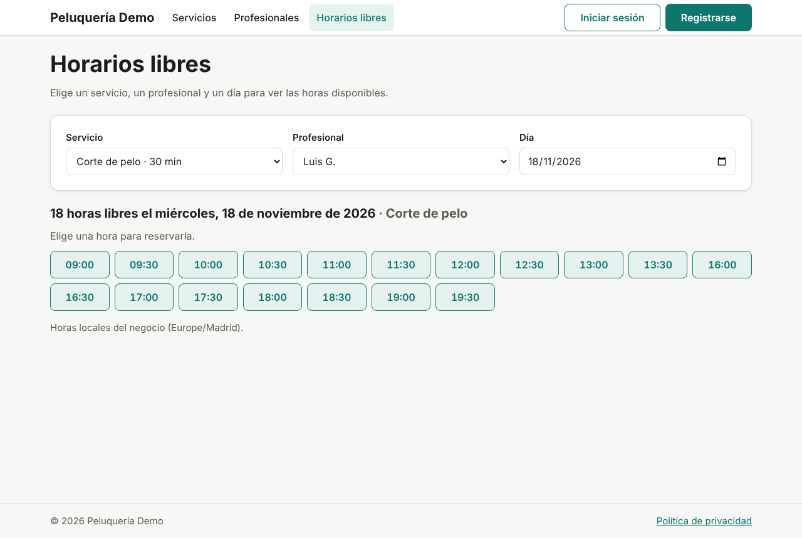

Al pulsar una hora libre, la web pide iniciar sesión o **Registrarse** y
después vuelve a esa misma hora. Para crear una cuenta hacen falta 14 años o
más y aceptar la política de privacidad.

## 2. Cliente

### Reservar

1. En **Reservar** (los horarios libres), elige servicio, profesional y día y
   pulsa una hora.
2. En **Reservar cita** se ve el resumen. Elige **para quién** es: para ti o
   para uno de tus menores a cargo.
3. Pulsa **Confirmar reserva**.

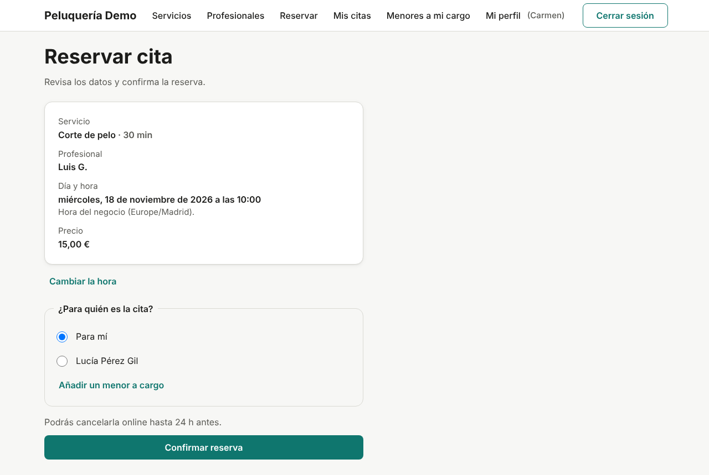

Si otra persona acaba de coger esa hora, la web lo dice y ofrece **elegir
otra hora**. Se puede reservar como mucho con 60 días de antelación (lo
configura el negocio).

### Mis citas y cancelar

**Mis citas** tiene dos pestañas: **Próximas** (también las canceladas) e
**Historial**. Al abrir una se ve el detalle: servicio, profesional, hora, precio y
para quién es.

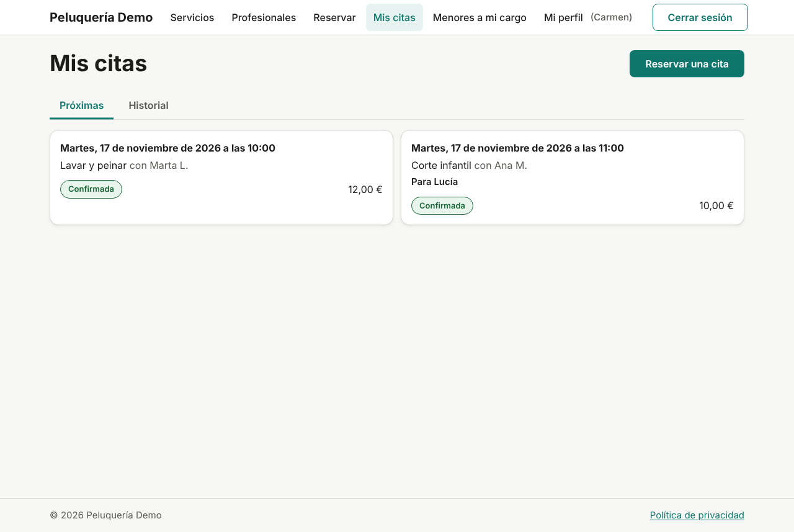

**Cancelar cita** solo aparece mientras falten 24 horas o más (lo configura
el negocio); la web dice hasta cuándo se puede. La cancelación se confirma
dentro de la misma página.

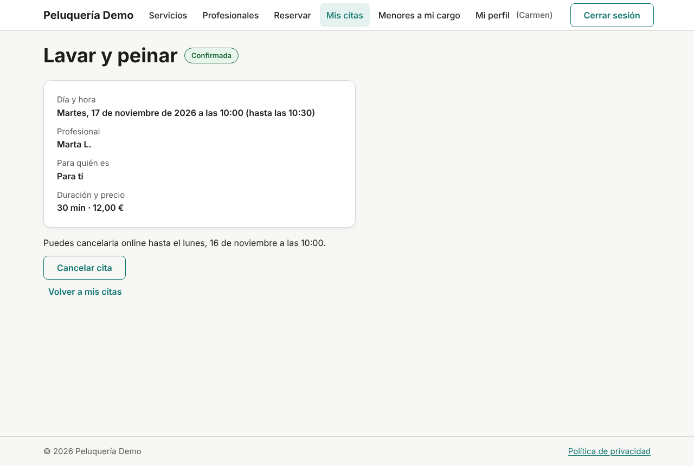

### Menores a mi cargo

Los menores de 14 años no tienen cuenta: los añade un adulto en **Menores a
mi cargo** (o al reservar, con **Añadir un menor**) y luego reserva para
ellos.

### Mi perfil

En el menú, **Mi perfil (tu nombre)** lleva a tu perfil:

- **Guardar datos:** nombre, apellidos, correo y teléfono.
- **Cambiar contraseña.**
- **Descargar mis datos:** todos tus datos personales en un archivo JSON.
- **Eliminar mi cuenta:** pide tu contraseña, cancela tus citas futuras y
  anonimiza tus datos. No se puede deshacer.

Si olvidas la contraseña, en **Iniciar sesión** está **¿Has olvidado la
contraseña?**: llega un enlace por correo que vale 30 minutos.

## 3. Empleado

Las cuentas de empleado las crea el administrador. El primer acceso es con
una contraseña temporal, y la web obliga a **elegir una contraseña nueva**
antes de seguir.

### Agenda

**Agenda** muestra la semana de lunes a domingo: tu horario de cada día, los
días de cierre y tus citas. Con **← Semana anterior** y **Semana siguiente →**
se cambia de semana.

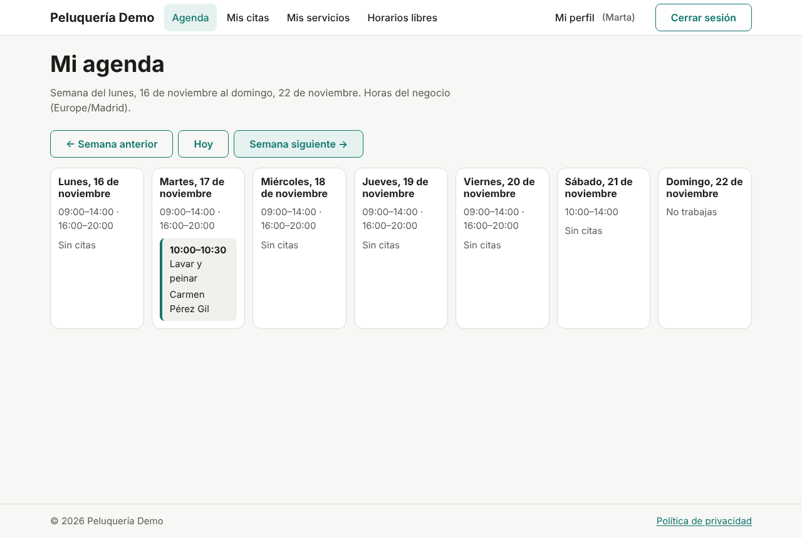

### Mis citas y su estado

**Mis citas** lista tus citas asignadas, con filtros de estado y fechas. En
el detalle se ven el cliente y su teléfono. Desde la hora de inicio se puede
**Marcar como completada** o **No presentado**; **Cancelar cita** pide un
motivo.

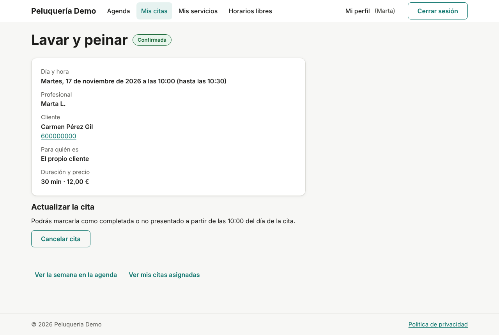

**Mis servicios** muestra los servicios que tienes asignados.

## 4. Administrador

El administrador inicial se crea al arrancar el backend con `ADMIN_EMAIL` y
`ADMIN_PASSWORD`.

### Reservas

**Reservas** lista todas las citas del negocio, con filtros de estado,
fechas, profesional y cliente. El detalle muestra además el correo del
cliente y el historial de cambios (quién reservó, canceló o completó).

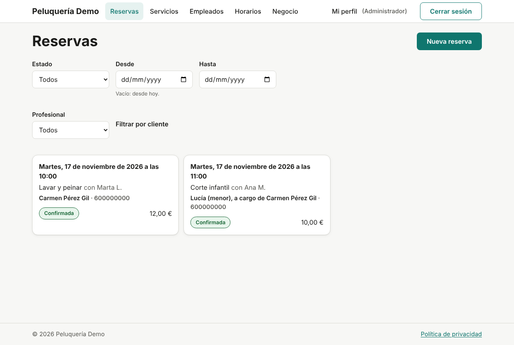

Con **Nueva reserva** se reserva por un cliente (por ejemplo, si llama por
teléfono): se elige la hora en los horarios libres, se busca al cliente con
**Buscar cliente** (tres letras o más) y para quién es.

### Servicios y empleados

- **Servicios:** alta, edición y **Desactivar**. La duración se elige de una
  lista de múltiplos del intervalo de reserva. Un servicio nunca se borra,
  para no perder el historial.
- **Empleados:** **Dar de alta** muestra **una sola vez** la contraseña
  temporal para dársela al empleado. En su ficha se cambian sus datos y sus
  servicios, se genera otra contraseña temporal o se desactiva la cuenta. Si
  tiene citas futuras, la web avisa y enlaza a ellas.

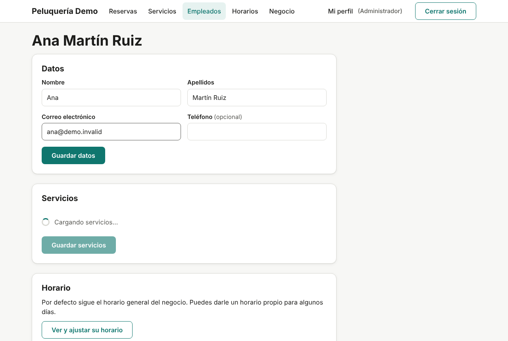

### Horarios y días de cierre

- **Horarios:** el horario general de la semana (hasta 4 tramos por día).
  Cada empleado puede tener días "como el general" o propios, desde su
  ficha.
- **Días de cierre:** festivos de todo el negocio o vacaciones de un
  empleado, con **Añadir un día de cierre**.

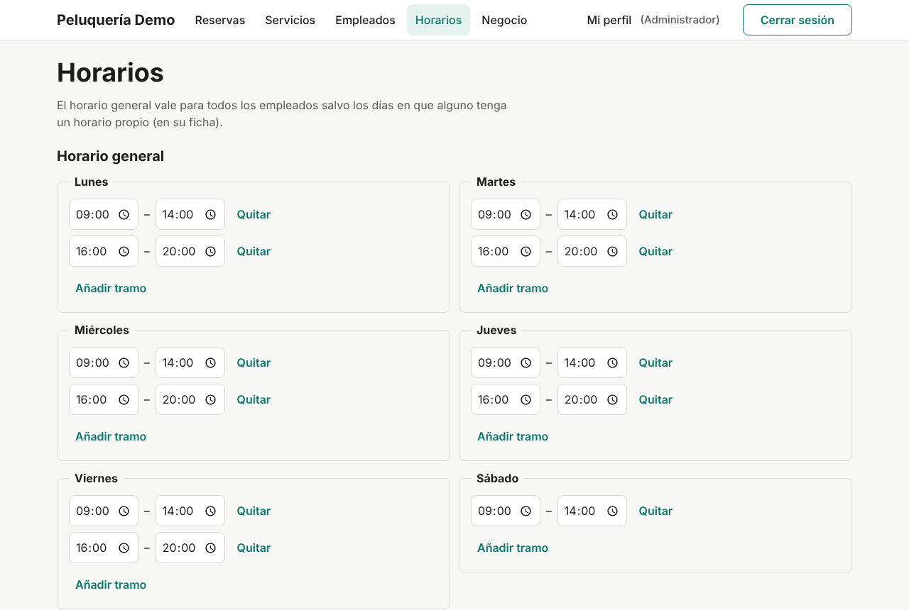

Guardar un horario o un cierre **nunca cancela citas**: si alguna queda
fuera, la web la lista para que decidas qué hacer con ella.

### Negocio

**Negocio** guarda el nombre, la zona horaria, el intervalo entre horas
(5 a 60 minutos), la antelación máxima para reservar, las horas mínimas para
cancelar y la edad mínima para tener cuenta. Cambiar el intervalo o la zona
pide confirmación.

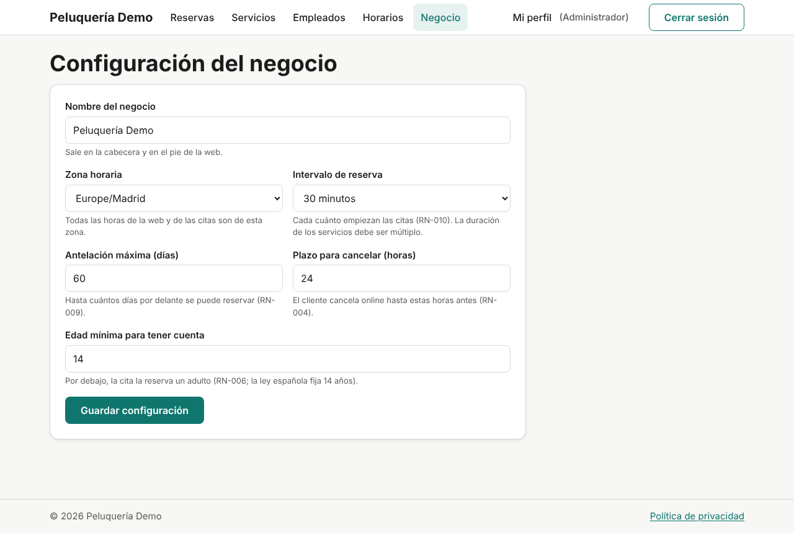

## En el móvil

| Horarios libres | Mis citas |
|---|---|
| 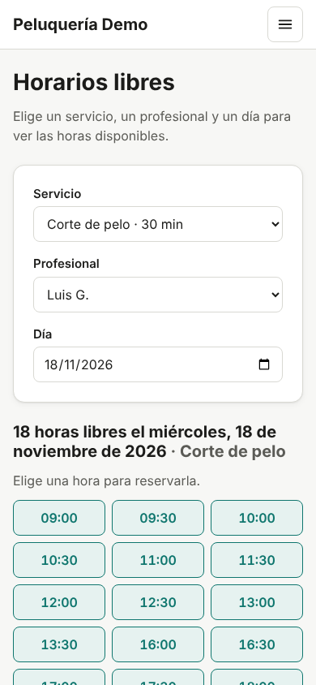 | 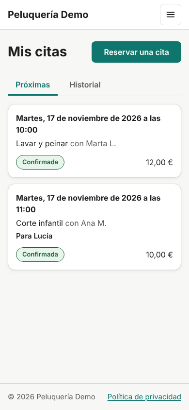 |
